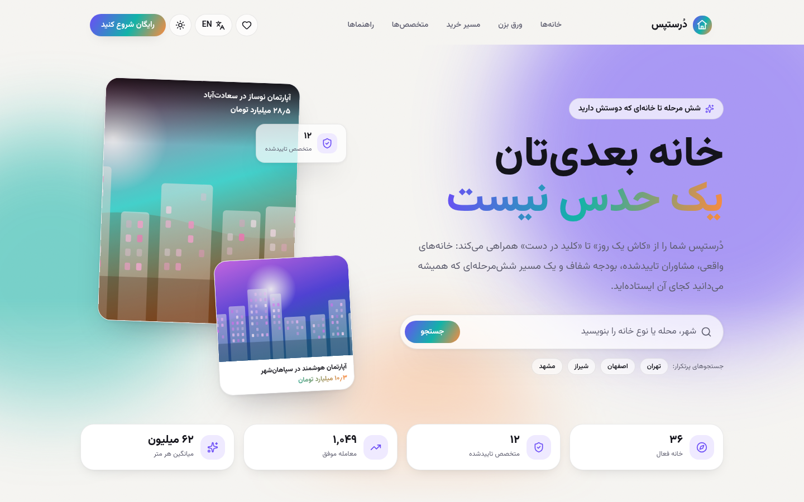
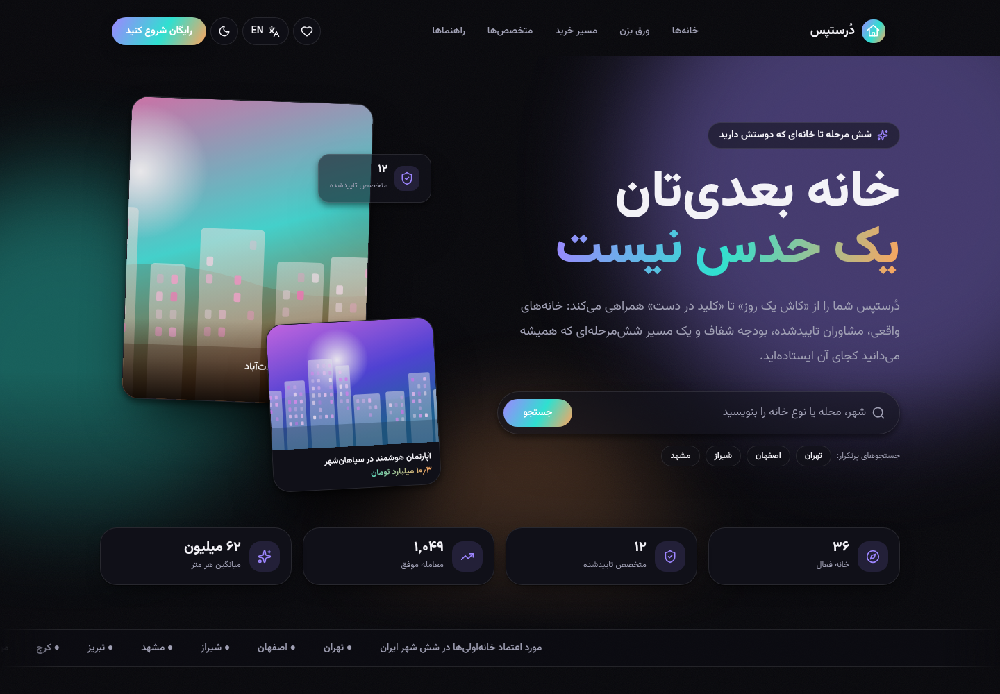
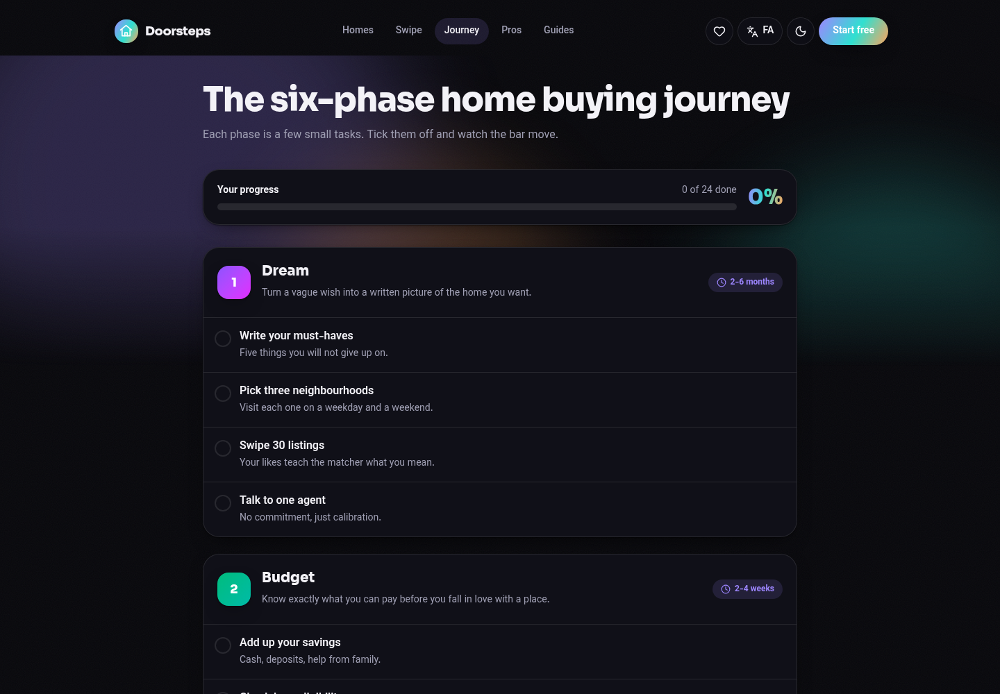
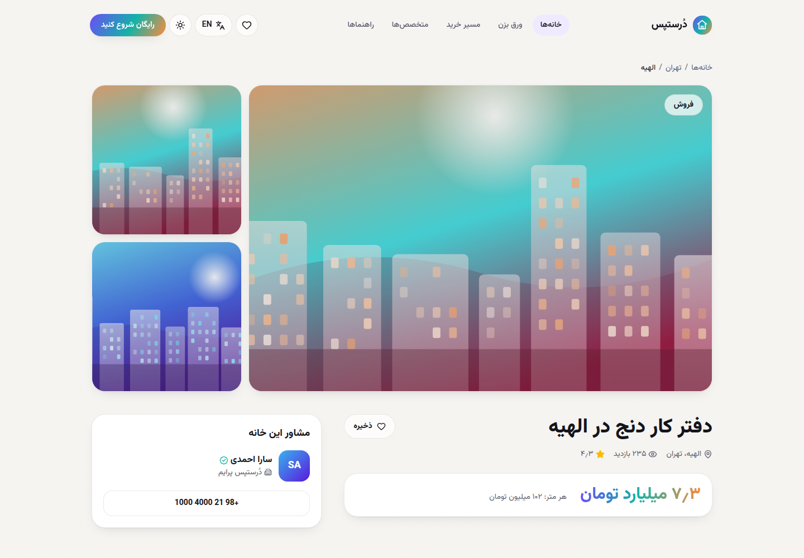
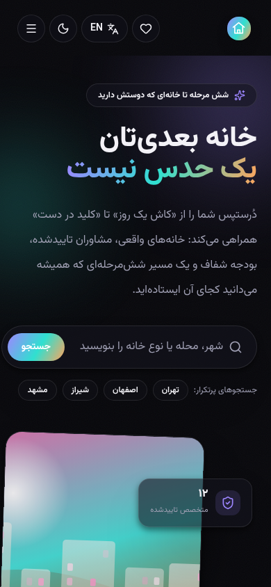

<div dir="rtl">

# دُرستپس — Doorsteps

پلتفرم راهنمای خرید خانه: از «کاش یک روز» تا «کلید در دست».
شش مرحله روشن، خانه‌های واقعی، متخصص‌های تاییدشده و یک تجربه کاربری دوزبانه (فارسی/انگلیسی) با حالت روشن و تاریک.

</div>

A guided home-buying platform inspired by the Doorsteps model (six phases, shared workspace with pros, expert tips) localized for the Iranian market.

---

## Screenshots

| Home (fa, light) | Home (fa, dark) | Journey (en, dark) |
| --- | --- | --- |
|  |  |  |

| Property (fa) | Mobile (fa, dark) |
| --- | --- |
|  |  |

## Stack

| Layer     | Tech |
| --------- | ---- |
| Frontend  | Next.js 16 (App Router, RSC), TypeScript, Tailwind CSS v4, Motion, next-themes, lucide-react |
| Backend   | FastAPI, SQLModel, SQLite (swappable via `DATABASE_URL`), Pydantic v2 |
| Delivery  | Docker Compose (multi-stage builds, standalone Next output), PWA manifest |

## Features

- **Bilingual fa/en with full RTL/LTR** — locale in the URL (`/fa`, `/en`), `proxy.ts` negotiates from cookie + `Accept-Language`. Persian copy follows the Persian UX-writing vocabulary (حساب کاربری، جستجو، نشانی، دیدگاه …).
- **Light / dark / system themes** — CSS custom-property design tokens, no flash on load.
- **Fully responsive** — mobile bottom-sheet filters, drawer navigation, fluid type.
- **Listings** — search, faceted filters (city, deal, type, beds, price, features), sorting, pagination, detail pages with gallery, facts, agent card and lead form.
- **Swipe** — the "Tinder for real estate" deck: drag, keyboard arrows, undo, live match list, likes persisted per anonymous profile.
- **Journey** — the six phases (Dream → Budget → Search → Offer → Close → Move in) with 24 checkable steps, progress persisted locally and on the API.
- **Pros directory** — agents, lenders, inspectors, designers, lawyers, movers, filterable by role.
- **Guides** — expert tips and checklists, bilingual.
- **Leads** — contact requests stored on the backend.

## Run with Docker (recommended)

```bash
cp .env.example .env      # optional, only to change the public API URL
docker compose up --build -d
```

| Service  | URL |
| -------- | --- |
| Web      | http://localhost:3400 |
| API      | http://localhost:8140 |
| API docs | http://localhost:8140/docs |

`PUBLIC_API_URL` is baked into the browser bundle at build time. When deploying to a real host, set it to the public API origin before `docker compose build`.

## Run locally

```bash
# backend
cd backend
python3 -m venv .venv && .venv/bin/pip install -r requirements.txt
.venv/bin/uvicorn app.main:app --reload --port 8140

# frontend (new shell)
cd frontend
npm install
echo "API_URL=http://localhost:8140"          >  .env.local
echo "NEXT_PUBLIC_API_URL=http://localhost:8140" >> .env.local
npm run dev -- -p 3400
```

Shortcuts live in the `Makefile`: `make api`, `make web`, `make up`, `make down`, `make seed`.

## Project layout

```
backend/
  app/
    main.py           FastAPI app, CORS, lifespan (create tables + seed)
    models.py         SQLModel tables (property, professional, phase, step, tip, lead …)
    seed.py           bilingual demo data: 36 homes, 12 pros, 6 phases, 24 steps, 8 guides
    serializers.py    API shapes — every text field ships as { en, fa }
    routers/          properties (list, facets, deck, swipe, favourites, detail)
                      journey (phases + progress), content (pros, tips, leads, stats)
frontend/
  app/[locale]/       locale-scoped root layout and pages
  components/         header, cards, filters, swipe deck, journey board, forms
  lib/                api client, i18n dictionaries, formatters, types
  public/img/         generated SVG artwork (scripts/gen-art.py)
scripts/gen-art.py    regenerates the abstract cover artwork
```

## API

| Method | Path | Notes |
| ------ | ---- | ----- |
| GET  | `/health` | liveness |
| GET  | `/api/properties` | `q, city, deal, kind, beds, min_price, max_price, features, sort, page, size` |
| GET  | `/api/properties/facets` | cities, kinds, features, price range |
| GET  | `/api/properties/deck` | swipe deck for a profile |
| POST | `/api/properties/{slug}/swipe` | like / skip |
| GET  | `/api/properties/favorites` | liked homes for a profile |
| GET  | `/api/properties/{slug}` | detail + similar |
| GET  | `/api/journey` | six phases with steps and progress |
| POST | `/api/journey/progress` | tick a step |
| GET  | `/api/pros`, `/api/pros/{id}` | directory |
| GET  | `/api/tips`, `/api/tips/{slug}` | guides |
| POST | `/api/leads` | contact request |
| GET  | `/api/stats` | homepage counters |

Interactive docs: `/docs` (Swagger) and `/redoc`.

## Next steps (planned)

1. **PWA** — the manifest and icons are already served; add a service worker (offline shell, cached listings) and an install prompt.
2. **APK / IPA** — wrap the PWA with Capacitor (`@capacitor/android`, `@capacitor/ios`) for store builds, or Trusted Web Activity for Android.
3. Accounts and saved searches, map view, real listing ingestion, payments for pro subscriptions.
